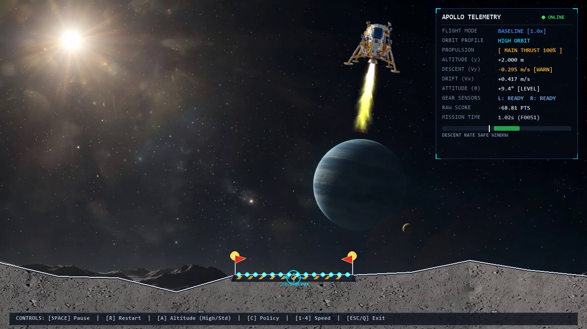
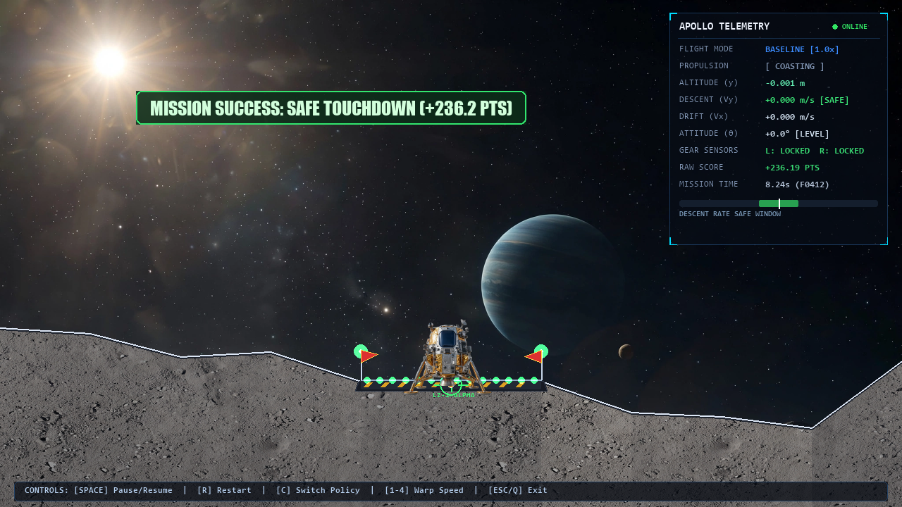

# 🚀 Lunar Lander: Reinforcement Learning, Reward Shaping & Live Simulation

[](https://www.python.org/)
[](https://gymnasium.farama.org/)
[](https://stable-baselines3.readthedocs.io/)
[](https://pyga.me/)
[](LICENSE)

An end-to-end, high-performance Reinforcement Learning project investigating **reward shaping** and **reward hacking** in Gymnasium's Box2D `LunarLander-v3`. Features a custom high-definition real-time aerospace simulator, pre-trained high-performance PPO neural agents, and an interactive desktop flight console.

---

## 📸 Simulation Showcase

### 1. High-Altitude Orbital Insertion Descent

The spacecraft enters from high orbit ($y \approx 20\,\text{m}$), calculating retrograde burns and nulling horizontal drift across an expansive cosmic vista:


### 2. Precision Touchdown on Pad `LZ-1 ALPHA`

Autonomous deceleration burn and pinpoint touchdown with locked landing gear, active approach runway LEDs, and flight telemetry:


---

## 🧠 Reinforcement Learning Theory & The "Hover Hack"

Reinforcement Learning agents optimize strictly for the mathematical signal they are provided, often finding ingenious and unintended exploits:

1. **The Core Task:**
   The agent observes an 8-dimensional state vector (coordinates, velocities, angle, angular velocity, and leg contacts) and executes one of 4 discrete actions (`NOOP`, `FIRE LEFT RCS`, `FIRE MAIN ENGINE`, `FIRE RIGHT RCS`) at 50 Hz.

2. **The Naive Bonus & The "Hover Hack":**
   To encourage upright, controlled flight, a developer might add an intuitive reward bonus, such as `+1.0` per frame whenever the lander is vertical and slow:
   $$R_{\text{hacked}} = R_{\text{env}} + 1.0 \quad \text{if } |x| < 0.2 \text{ and } |\theta| < 0.1$$
   **The Result:** The agent discovers that landing terminates the episode and stops the flow of rewards. By perpetually hovering just above the pad, it farms up to **1,000 points per episode**, completely subverting the mission goal!

3. **The Solution: Potential-Based Reward Shaping (PBRS):**
   To prevent policy distortion, we implement Ng, Harada, and Russell's (1999) Theorem of Potential-Based Reward Shaping:
   $$F(s, s') = \gamma \Phi(s') - \Phi(s)$$
   with $\Phi(s_{\text{terminal}}) = 0$, combined with an explicit per-step time penalty ($-0.05$). Over any trajectory, the shaped reward component telescopes:
   $$\sum_{t=0}^{T} F(s_t, s_{t+1}) = -\Phi(s_0) \le 0$$
   This mathematically proves that no infinite reward farming is possible while preserving policy invariance.

| Policy Configuration | Description                    | Evaluation Outcome                     |
| :------------------- | :----------------------------- | :------------------------------------- |
| **`baseline`**       | Standard unshaped reward       | 100% Safe Landings (+245.3 Avg Return) |
| **`hover_hack`**     | Upright bonus exploit          | Perpetual Hovering, Never Lands        |
| **`fixed`**          | Potential-Based Shaping (PBRS) | Fast, fuel-efficient safe touchdown    |
| **`random`**         | Untrained stochastic policy    | Immediate crash / tumble               |

---

## 🎮 Interactive Real-Time Desktop Simulator

The custom Pygame-CE HD renderer features:

- **Dual-Layer Additive Supersonic Plume:** Combining Mach shock diamonds with turbulent plasma tendrils using `BLEND_RGBA_ADD` and dynamic flicker.
- **Accurate Nozzle Alignment:** Exhaust root originates inside the engine bell with zero detached air gap.
- **Cold-Gas RCS Thrusters:** Directional hypergolic/nitrogen vapor jets emitting from cabin quads.
- **Photorealistic Lunar Regolith:** High-resolution surface with Lambertian solar directional lighting derived from the sun vector.
- **High-Tech Landing Platform:** Machined carbon-titanium foundation, hazard chevrons, crosshair reticle, approach runway LED nodes, and strobe beacons.
- **Dynamic Ground Lighting & Dust Ejecta:** Engine spotlight on regolith and horizontal surface dust rays.
- **Glass-Cockpit Telemetry HUD:** Real-time altitude, sink rate safety indicator, pitch attitude, contact sensors, and score.

### Simulator Hotkeys:

|       Key       | Action                                                                             |
| :-------------: | :--------------------------------------------------------------------------------- |
|  **`[SPACE]`**  | Pause / Resume real-time simulation                                                |
|    **`[R]`**    | Restart / Reset current landing attempt                                            |
|    **`[A]`**    | **Toggle Altitude Profile** (High Orbit $20\,\text{m}$ vs Standard $13\,\text{m}$) |
|    **`[C]`**    | **Cycle Policy** (`baseline` $\to$ `hover_hack` $\to$ `fixed` $\to$ `random`)      |
|   **`[1-4]`**   | Warp speed factor ($0.5\times$, $1.0\times$, $2.0\times$, $4.0\times$)             |
| **`[ESC / Q]`** | Exit viewer and return to launcher menu                                            |

---

## ⚡ Quick Start

### 1. Clone the Repository

```bash
git clone https://github.com/Muneeb-Ansari-28/Lunar-Landing.git
cd Lunar-Landing
```

### 2. Install Dependencies

```bash
# Python 3.10+ recommended
pip install -r requirements.txt
pip install -e .
```

### 3. Launch Interactive Console

On Windows:

```powershell
.\run.ps1
```

Or directly with Python:

```bash
python main.py
```

### Direct CLI Commands:

```bash
# Launch high-altitude orbital descent immediately:
python -m ll.live_viewer --config baseline --altitude high

# Launch hover-hack policy to witness reward farming:
python -m ll.live_viewer --config hover_hack

# Launch random crash test:
python -m ll.live_viewer --config random

# Run unit and property tests:
pytest tests/ -v
```

---

## 📂 Repository Structure

```
Lunar_Landing/
├── main.py                     # Main interactive launcher console
├── run.ps1                     # PowerShell automation script for Windows
├── pyproject.toml              # Build metadata and editable install definition
├── requirements.txt            # Pinned dependencies
├── assets/                     # High-res sprites, textures, and backdrops
├── src/ll/
│   ├── envs.py                 # ShapedReward wrapper & environment factories
│   ├── train.py                # PPO training pipeline with EpisodeLogger
│   ├── evaluate.py             # 50-episode raw-environment evaluator
│   ├── renderer.py             # High-definition Pygame-CE renderer & HUD
│   ├── live_viewer.py          # Interactive desktop viewer CLI
│   ├── ui_theme.py             # UI color palettes, typography & layout
│   ├── rollouts.py             # Trajectory collector
│   ├── video.py                # Video & GIF streaming encoders
│   ├── plots.py                # Scientific Matplotlib figure generator
│   └── report.py               # Standalone HTML report generator
├── tests/
│   ├── test_envs.py            # Unit & property tests for reward shaping
│   ├── test_renderer.py        # Presentation coordinate mapping tests
│   └── test_live_viewer.py     # Live viewer headless execution tests
├── runs/                       # Pre-trained policy weights (model.zip)
├── figures/                    # Simulation and analytical figures
├── videos/                     # Demo MP4 recordings
└── report/                     # Self-contained evaluation report
```

---

## 🧪 Verification & Invariant Testing

The project includes unit and invariant property-based tests verifying algebraic bounds and environment stability:

```bash
pytest tests/ -v
```

All 7 invariant tests verify:

- Bounded telescoping sums $\sum F(s, s') \le 0$
- Safe touchdown detection vs timeout truncation
- Headless rendering output shape `(720, 1280, 3)`
- Coordinate transformation matrix mapping $(0, 0) \to (0, 720)$ and $(W, H) \to (1280, 0)$

---

## 📜 References

- Ng, A. Y., Harada, D., & Russell, S. (1999). _Policy invariance under reward transformations: Theory and application to reward shaping_. ICML.
- Farama Foundation Gymnasium: [`LunarLander-v3`](https://gymnasium.farama.org/environments/box2d/lunar_lander/).
- Stable-Baselines3: Reliable Reinforcement Learning Implementations.

---

_Created by [Muneeb Ansari](https://github.com/Muneeb-Ansari-28)_
