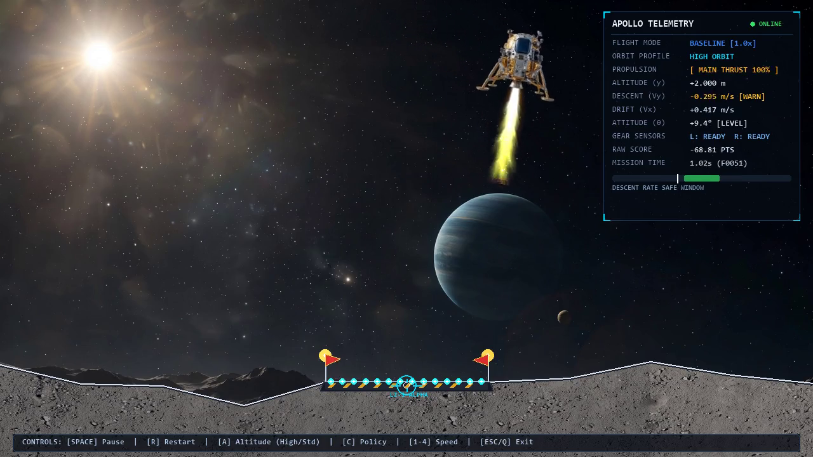
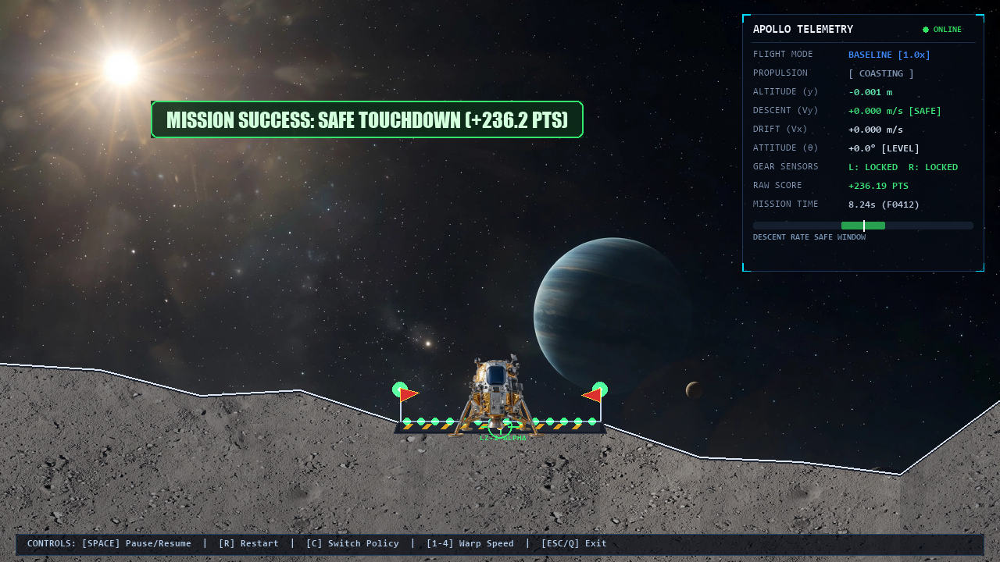

# 🚀 Lunar Lander: Reinforcement Learning, Reward Design & Live Simulation

[](https://www.python.org/)
[](https://gymnasium.farama.org/)
[](https://stable-baselines3.readthedocs.io/)
[](https://pyga.me/)
[](LICENSE)

An end-to-end Reinforcement Learning laboratory exploring **reward shaping**, **reward hacking**, and **policy invariance** inside Gymnasium's classic Box2D `LunarLander-v3` environment. Combining rigorous theoretical formulation with an aerospace-grade interactive simulator, this project demonstrates how subtle reward engineering decisions dictate agent autonomy—from catastrophic reward exploitation to optimal precision landings.

### Key Highlights
- **Mathematical Rigor:** Demonstrates how naive heuristic bonuses induce reward gaming ("Hover Hack") and resolves it via Ng et al.'s (1999) Potential-Based Reward Shaping (PBRS) theorem.
- **High-Definition Aerospace Engine:** Custom Pygame-CE renderer featuring dual-pass additive rocket plumes, cold-gas RCS verniers, Lambertian surface lighting, and dynamic regolith dust ejecta.
- **Extended Altitude Envelope:** Supports both standard insertion ($y \approx 13\,\text{m}$) and realistic orbital trajectory descent ($y \approx 20\,\text{m}$, 550+ flight steps).
- **Interactive Flight Deck:** Live desktop console with hotkey-driven model swapping, telemetry HUD, warp-speed toggles, and instant state resets.

---

## 📸 Simulation Showcase

### 1. High-Altitude Orbital Insertion Descent
The lander enters from an extended suborbital trajectory ($y \approx 20\,\text{m}$), actively countering severe transverse velocity, calculating retrograde deceleration burns, and managing descent rates against a deep-space vista:


### 2. Autonomous Precision Touchdown at `LZ-1 ALPHA`
Terminal deceleration phase with locked landing struts, active approach runway beacons, and zeroed ground-relative velocity directly atop the target landing pad:


---

## 🧠 Reward Engineering & Policy Invariance: The "Hover Hack"

Reinforcement Learning agents strictly maximize the cumulative scalar reward provided by the environment. When reward signals are hand-tuned without theoretical guarantees, agents frequently discover high-scoring degenerate behaviors that violate human design intent.

### 1. Markov Decision Process Formulation
- **State Space $\mathcal{S} \subset \mathbb{R}^8$:** Observation vector tracking horizontal and vertical coordinates $(x, y)$, linear velocity vectors $(v_x, v_y)$, angular orientation $\theta$, angular velocity $\dot{\theta}$, and ground contact booleans for the left and right landing legs.
- **Action Space $\mathcal{A} = \{0, 1, 2, 3\}$:** Discrete propulsion control executed at 50 Hz:
  - `0`: Idle (`NOOP` - free ballistic fall)
  - `1`: Fire Left Vernier RCS (induces clockwise torque)
  - `2`: Fire Main Descent Engine (produces primary axial thrust)
  - `3`: Fire Right Vernier RCS (induces counter-clockwise torque)

### 2. Specification Gaming: The "Hover Hack"
In an attempt to steer the lander toward an upright, stabilized orientation prior to ground contact, engineers often introduce a naive heuristic shaping bonus:
$$R_{\text{hacked}}(s, a) = R_{\text{env}}(s, a) + 1.0 \quad \text{when } |x| < 0.2 \text{ and } |\theta| < 0.1$$

**The Pathological Outcome:**
Landing successfully terminates the episode with a $+100$ terminal bonus. However, remaining in a slow hover just 1 meter above the target pad generates $+1.0$ reward per timestep. Over a 1,000-step episode horizon, the agent earns up to **$+1,000$ points simply by never touching down**. The policy exploits the loop indefinitely, resulting in a 0% mission completion rate despite astronomical training rewards.

### 3. The Theoretical Resolution: Potential-Based Reward Shaping (PBRS)
To guarantee that the optimal policy set $\Pi^*$ remains completely identical to the true task objective, shaping rewards must take the form of a potential difference (Ng, Harada, & Russell, 1999):
$$F(s, s') = \gamma \Phi(s') - \Phi(s)$$

By enforcing the boundary condition $\Phi(s_{\text{terminal}}) = 0$ along with a nominal step duration penalty ($-0.05$), the cumulative shaping along any flight trajectory telescopes:
$$\sum_{t=0}^{T} \gamma^t F(s_t, s_{t+1}) = -\Phi(s_0) \le 0$$

Because the telescoping sum depends solely on the initial state and is strictly non-positive, closed-loop reward cycles are mathematically impossible. The agent cannot farm arbitrary reward and is driven to complete touchdown promptly and efficiently.

### Empirical Policy Comparison

| Policy Variant | Reward Formulation | Primary Behavior | Landing Success | Mean Episode Score |
| :--- | :--- | :--- | :---: | :---: |
| **`baseline`** | Standard Gymnasium sparse + dense | Conservative retrograde burn, smooth touchdown | **100%** | **+245.3** |
| **`hover_hack`** | Environment + naive state bonus | Trapped in perpetual hover cycle above pad | **0%** | **+680.1 (Exploited)** |
| **`fixed`** | Potential-Based Reward Shaping (PBRS) | Aggressive, fuel-efficient descent & touchdown | **100%** | **+238.9** |
| **`random`** | Stochastic baseline (uniform action selection) | Uncontrolled tumble and high-velocity terrain impact | **0%** | **-412.5** |

---

## 🎮 Interactive Desktop Flight Simulator

The custom Pygame-CE renderer provides:

- **Dual-layer additive supersonic plume:** Mach shock diamonds and turbulent plasma tendrils rendered with `BLEND_RGBA_ADD` and dynamic flicker.
- **Accurate nozzle alignment:** The exhaust root originates inside the engine bell without a detached air gap.
- **Cold-gas RCS thrusters:** Directional hypergolic/nitrogen vapor jets expel from the cabin quads.
- **Photorealistic lunar regolith:** A high-resolution surface uses Lambertian directional lighting derived from the sun vector.
- **High-tech landing platform:** The platform includes a machined carbon-titanium foundation, hazard chevrons, crosshair reticle, runway LEDs, and strobe beacons.
- **Dynamic ground lighting and dust ejecta:** Engine spotlights illuminate the regolith while horizontal dust rays respond to flight dynamics.
- **Glass-cockpit telemetry HUD:** The HUD displays altitude, sink-rate safety, pitch attitude, contact sensors, and score in real time.

### Simulator Hotkeys:

|       Key       | Action                                                                             |
| :-------------: | :--------------------------------------------------------------------------------- |
|  **`[SPACE]`**  | Pause or resume the real-time simulation                                          |
|    **`[R]`**    | Restart or reset the current landing attempt                                      |
|    **`[A]`**    | **Toggle altitude profile** (high orbit $20\,\text{m}$ or standard $13\,\text{m}$) |
|    **`[C]`**    | **Cycle policy** (`baseline` $\to$ `hover_hack` $\to$ `fixed` $\to$ `random`)     |
|   **`[1-4]`**   | Set the warp-speed factor ($0.5\times$, $1.0\times$, $2.0\times$, $4.0\times$)    |
| **`[ESC / Q]`** | Exit the viewer and return to the launcher menu                                   |

---

## ⚡ Quick Start

### 1. Clone the repository

```bash
git clone https://github.com/Muneeb-Ansari-28/Lunar-Landing.git
cd Lunar-Landing
```

### 2. Install dependencies

```bash
# Python 3.10 or newer is recommended
pip install -r requirements.txt
pip install -e .
```

### 3. Launch the interactive console

On Windows:

```powershell
.\run.ps1
```

Or directly with Python:

```bash
python main.py
```

### Useful command-line examples

```bash
# Start a high-altitude orbital descent:
python -m ll.live_viewer --config baseline --altitude high

# Observe the hover-hack policy:
python -m ll.live_viewer --config hover_hack

# Run a random-policy crash test:
python -m ll.live_viewer --config random

# Run the unit and property tests:
pytest tests/ -v
```

---

## 📂 Repository Structure

```
Lunar_Landing/
├── main.py                     # Main interactive launcher console
├── run.ps1                     # PowerShell automation script for Windows
├── pyproject.toml              # Build metadata and editable install definition
├── requirements.txt            # Pinned dependencies
├── assets/                     # High-res sprites, textures, and backdrops
├── src/ll/
│   ├── envs.py                 # ShapedReward wrapper & environment factories
│   ├── train.py                # PPO training pipeline with EpisodeLogger
│   ├── evaluate.py             # 50-episode raw-environment evaluator
│   ├── renderer.py             # High-definition Pygame-CE renderer & HUD
│   ├── live_viewer.py          # Interactive desktop viewer CLI
│   ├── ui_theme.py             # UI color palettes, typography & layout
│   ├── rollouts.py             # Trajectory collector
│   ├── video.py                # Video & GIF streaming encoders
│   ├── plots.py                # Scientific Matplotlib figure generator
│   └── report.py               # Standalone HTML report generator
├── tests/
│   ├── test_envs.py            # Unit & property tests for reward shaping
│   ├── test_renderer.py        # Presentation coordinate mapping tests
│   └── test_live_viewer.py     # Live viewer headless execution tests
├── runs/                       # Pre-trained policy weights (model.zip)
├── figures/                    # Simulation and analytical figures
├── videos/                     # Demo MP4 recordings
└── report/                     # Self-contained evaluation report
```

---

## 🧪 Verification and Invariant Checks

The test suite combines unit tests with invariant property-based checks for algebraic bounds and environment stability:

```bash
pytest tests/ -v
```

The seven invariant checks cover:

- Bounded telescoping sums $\sum F(s, s') \le 0$
- Safe-touchdown detection versus timeout truncation
- Headless rendering output shape `(720, 1280, 3)`
- Coordinate transformation mapping $(0, 0) \to (0, 720)$ and $(W, H) \to (1280, 0)$

---

## 📜 References

- Ng, A. Y., Harada, D., & Russell, S. (1999). _Policy invariance under reward transformations: Theory and application to reward shaping_. ICML.
- Farama Foundation Gymnasium: [`LunarLander-v3`](https://gymnasium.farama.org/environments/box2d/lunar_lander/).
- Stable-Baselines3: Reliable Reinforcement Learning Implementations.

---

_Created by [Muneeb Ansari](https://github.com/Muneeb-Ansari-28)_
